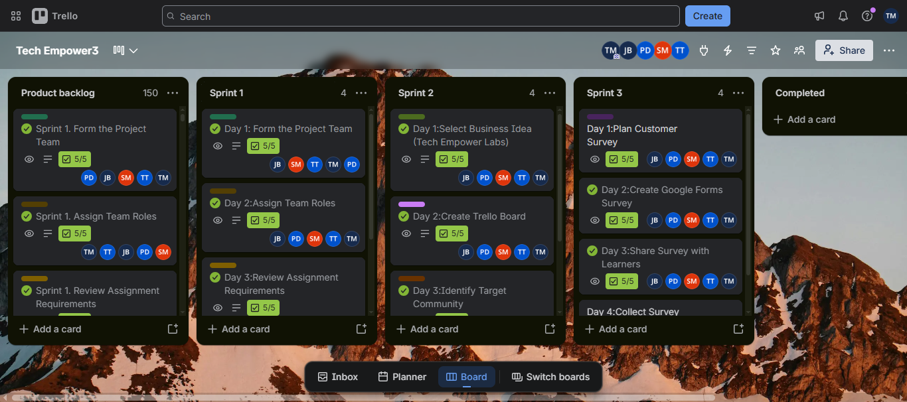

# Assessment 3: Product Backlog

The product backlog is an organised list of project features, requirements, and tasks. Items can be prioritised according to their value and importance.

## Evidence

## How the Backlog Helps
- Keeps project requirements in one place.
- Helps the team prioritise work.
- Makes outstanding tasks visible.
- Can be updated when requirements change.

## Reflection
The product backlog helps the team organise requirements and decide which work should be prioritised. Keeping it updated gives the team a shared reference when planning sprints. Make sure the screenshot is genuine and readable.
