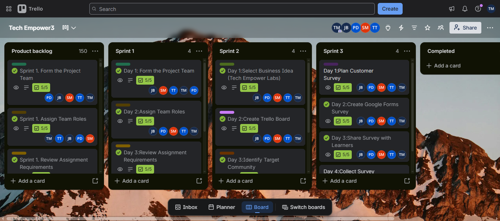

#Product Backlog

A product backlog is a prioritised list of features, requirements, improvements, and tasks that may need to be completed during a project. It provides the team with a shared understanding of the work required to develop the product.

For Tech Empower Labs, the product backlog helps organise project requirements and identify which activities should receive attention first. The backlog can be reviewed and updated as the team gains a better understanding of the project or identifies new requirements.

Maintaining a clear product backlog supports planning, prioritisation, transparency, and communication among team members.

## Evidence

## How the Backlog Helps
- Keeps project requirements in one place.
- Helps the team prioritise work.
- Makes outstanding tasks visible.
- Can be updated when requirements change.

## Reflection
The product backlog brought all the work for Tech Empower Labs into one place. Our Trello board holds around 150 cards, which showed me how quickly a project grows once every feature, task and improvement is written down. Seeing it all together helped me understand why Agile teams keep a single, ordered list instead of working from scattered notes.

The most important lesson was about prioritisation. Not everything in the backlog carries the same value, and a team cannot do everything at once. As Product Owner, I learned that deciding what comes first means weighing user needs, project goals and the time available. Items near the top need to be clearly described and ready to work on, while items further down can stay rough until they move closer.

A challenge was keeping such a long list organised and understandable. Cards without clear titles or descriptions are easy to overlook or misunderstand. I also saw that a backlog can become outdated quickly if nobody maintains it, so it has to be a living document and not a list written once and forgotten.

In future projects, I would hold regular backlog refinement sessions with the team to remove duplicates, clarify unclear items and reorder work as priorities change. I would also use clearer labels to group related work. The backlog connects the sections of my portfolio. It grows out of the user stories and it supplies the work that the team pulls into each sprint.
