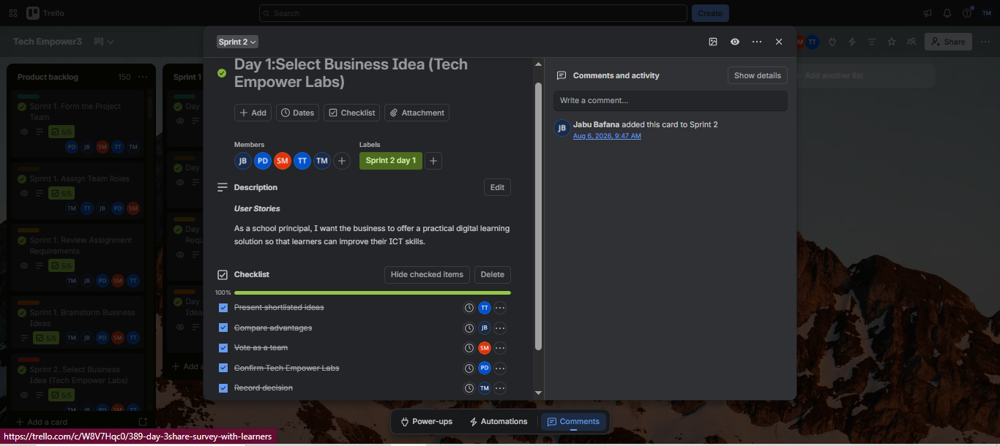
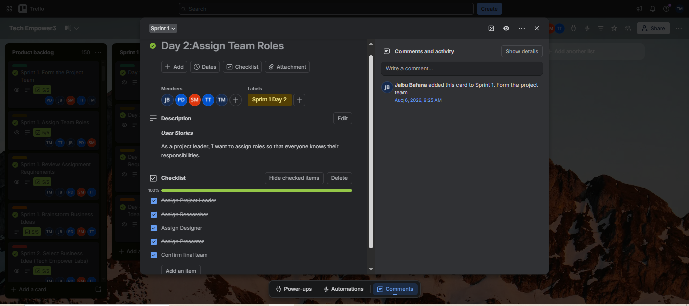
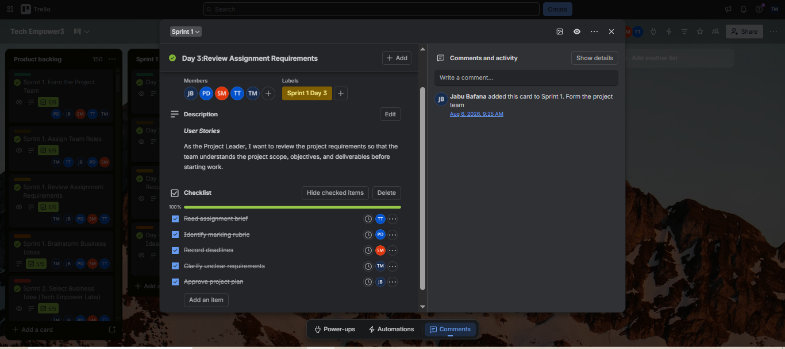
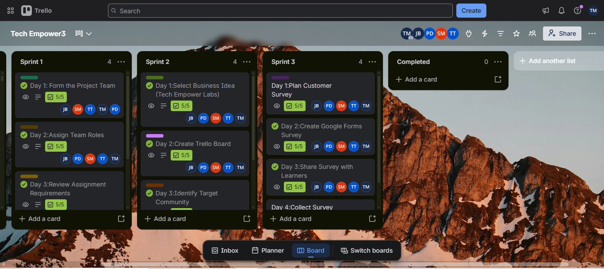

# Sprint Backlog

The sprint backlog contains the work selected for a sprint and the tasks needed to complete it.
A sprint backlog is the collection of work selected for a sprint, together with the tasks needed to achieve the sprint goal. A sprint is a fixed period during which the team works towards completing a planned set of activities.

In the Tech Empower Labs project, sprint planning helps the team break larger project objectives into smaller tasks that can be managed within a specific period. Team members can monitor progress, identify incomplete work, and recognise possible delays or blockers.

The sprint backlog also supports accountability because team members can see which tasks are planned, in progress, or completed. At the end of a sprint, the team can review its progress and use what it learned to improve future planning.

## Sprint 1

## Sprint 2

## Sprint 3

## Sprint Code Evidence

## Reflection
Working with sprint backlogs showed me how a large project can be divided into short, focused stages. On our Trello board, Sprint 1 covered forming the team, assigning roles and reviewing the assignment requirements. Sprint 2 moved on to selecting our business idea, creating the Trello board and identifying the target community. Sprint 3 focused on planning and running a customer survey. Looking back, each sprint had a clear purpose and built on the one before it.

Breaking each sprint into daily cards made the work easier to track. Every card had a checklist, and I could see at a glance which tasks were complete and who was responsible. This visibility improved accountability, because nobody could be unsure about what was expected of them on a given day.

I learned that a sprint backlog is a commitment to a realistic amount of work, not a wish list. Choosing items from the product backlog meant deciding what the team could genuinely finish in the time available. A challenge was estimating how long tasks would take, because some depended on other team members completing their part first.

In future projects, I would run a short sprint review and retrospective at the end of each sprint to record what went well, what slowed us down and what to change next time. I would also move cards across the board more consistently so the board always shows the true state of the work. The sprint backlog connects directly to the logbook, where we recorded our daily progress and blockers..
