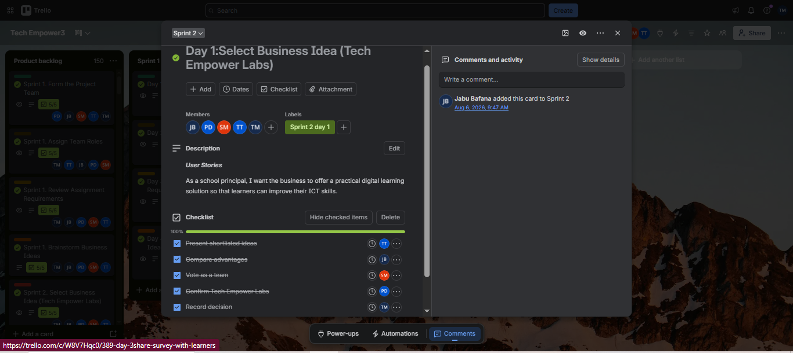
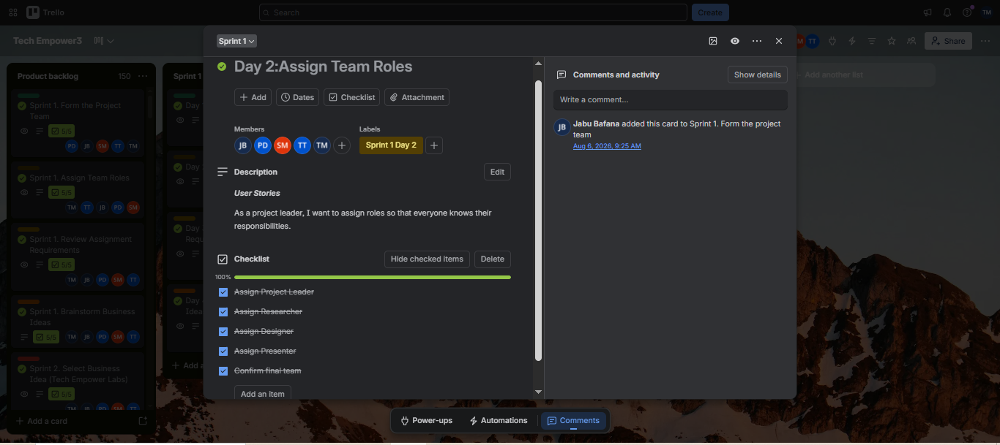
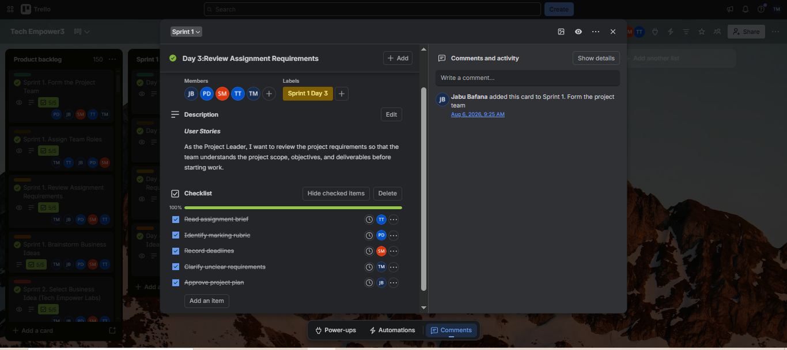
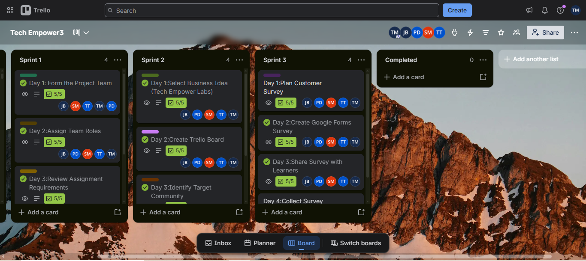

# Sprint Backlog

The sprint backlog contains the work selected for a sprint and the tasks needed to complete it.
A sprint backlog is the collection of work selected for a sprint, together with the tasks needed to achieve the sprint goal. A sprint is a fixed period during which the team works towards completing a planned set of activities.

In the Tech Empower Labs project, sprint planning helps the team break larger project objectives into smaller tasks that can be managed within a specific period. Team members can monitor progress, identify incomplete work, and recognise possible delays or blockers.

The sprint backlog also supports accountability because team members can see which tasks are planned, in progress, or completed. At the end of a sprint, the team can review its progress and use what it learned to improve future planning.

## Sprint 1

## Sprint 2

## Sprint 3

## Sprint Code Evidence

## Reflection
Sprint planning helps the team decide what can realistically be completed in a set period. Breaking work into smaller tasks makes progress easier to track and clarifies each member's responsibilities. Reviewing the sprint backlog can also reveal delayed tasks or blockers.
