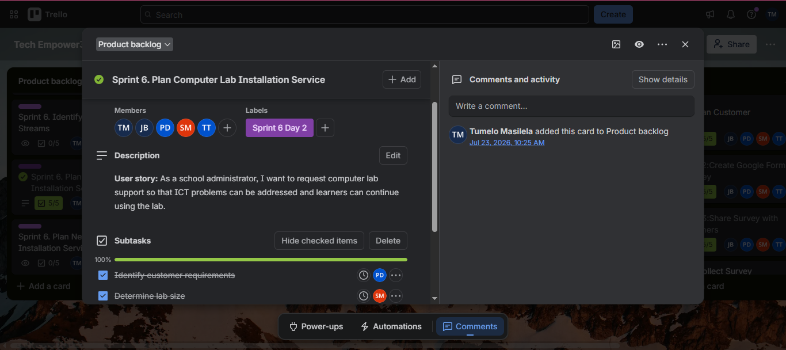
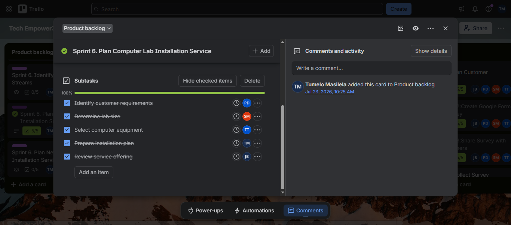

# User Stories and Tasks

User stories describe what a user needs and why. Tasks divide the work into smaller activities that the team can complete,
also User stories describe a feature or service from the user's perspective. They explain who needs something, what they need, and why it is important. Tasks divide the work required to fulfil a user story into smaller, manageable activities.

In the Tech Empower Labs project, user stories help the team understand the needs of the intended users and identify the functionality the project should provide. Tasks make it easier to assign responsibilities, monitor progress, and ensure that the team focuses on delivering useful outcomes.

## Evidence

## Reflection
Writing user stories changed the way I think about a project. Instead of starting with the technology, I had to start with the people who will use the service: learners and teachers in under-resourced schools. Describing each requirement from their point of view kept the focus on what they actually need, such as access to devices, internet and structured IT training, and not on what we assumed would be impressive to build.

Breaking each story into smaller tasks and checklists on Trello taught me how large goals become manageable. A story on its own can feel too big to start. Once it is divided into clear tasks, each team member can see exactly what to do next and when a piece of work is complete. The checklists on our cards also gave us a simple, visible way to measure progress.

The main challenge was deciding how much detail each story and task needed. If a task is too vague, people interpret it differently. If it is too detailed, planning takes more time than the work itself. Through this activity I began to understand how to find a sensible balance.

In future projects, I would confirm the user stories with the people they describe, for example by using the survey results from our target community, before committing to a plan. I would also add clearer acceptance criteria to each story so the team agrees on what “done” means. This section feeds directly into the product backlog, because every story and task became an item that could be prioritised and scheduled.
