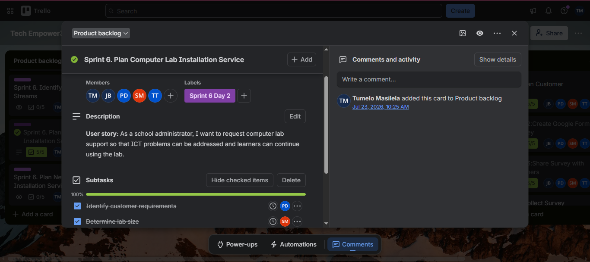
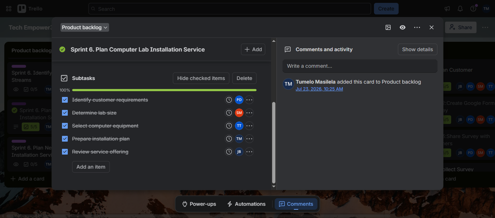

# Assessment 2: User Stories and Tasks

User stories describe what a user needs and why. Tasks divide the work into smaller activities that the team can complete.

## User Story Format

## Evidence

## Reflection
Writing user stories helps the team focus on user needs. Breaking stories into tasks makes work easier to assign and track. The Trello board gives the team a shared view of what needs to be done and what is in progress. Replace the example image names with your actual filenames.
